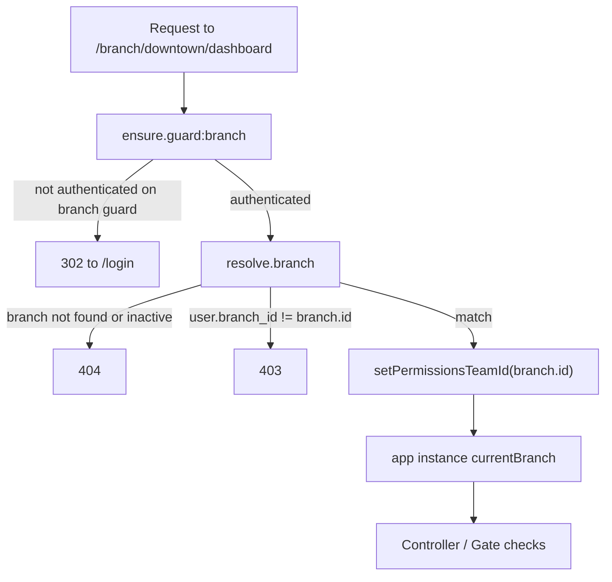

# Middleware and tenancy

Two custom middleware enforce the entire cross-portal isolation boundary. Get these right and
the rest of the app can trust `Auth::user()` and the active Spatie team without re-checking.

## `EnsurePortalGuard`

**File:** `app/Http/Middleware/EnsurePortalGuard.php` · **Alias:** `ensure.guard`

Parametrized by portal name (`ensure.guard:platform`, `ensure.guard:branch`, `ensure.guard:driver`,
`ensure.guard:customer`). For the given guard parameter, it:

1. Checks `Auth::guard($param)->check()`. If not authenticated on **that specific guard**,
   redirects to `/login`, preserving the intended URL in the session so the user returns here
   after logging in.
2. If authenticated on that guard, calls `Auth::shouldUse($param)` so `Auth::user()` resolves
   correctly for the rest of the request.
3. Checks the user's `is_active` flag. If `false`, logs them out of that guard and redirects to
   `/login` with an error — a deactivated account can never reach a dashboard even mid-session.

This is what makes a platform user hitting `/branch/*` get redirected to `/login` instead of a
403: they are not authenticated on the `branch` guard at all, so step 1 fails immediately. A 403
would imply "you're recognized here but not allowed" — that's not true; they were never
recognized on this guard in the first place.

## `ResolveBranchContext`

**File:** `app/Http/Middleware/ResolveBranchContext.php` · **Alias:** `resolve.branch`

Runs only on the branch portal's route group, **after** `ensure.guard:branch`. For the `{branch}`
route parameter (a slug):

1. Resolves it to a `Branch` model — 404 if not found or inactive.
2. Confirms the authenticated branch-guard user's `branch_id` matches this branch's id. If not,
   `abort(403)` with a clear message. **This is a hard 403, not a silent redirect into their own
   branch** — the isolation failure must be loud and testable, not swallowed.
3. Calls `app(\Spatie\Permission\PermissionRegistrar::class)->setPermissionsTeamId($branch->id)`
   so every subsequent Spatie permission/role check in this request is scoped to the correct
   branch team — overriding `PlatformTeamResolver`'s default of `0` for the duration of this
   request only.
4. Binds the resolved branch into the container (`app()->instance('currentBranch', $branch)`) so
   controllers don't need to re-resolve it from the route parameter.

### Why branch isolation is 403, not redirect-to-login

| Scenario | Response | Reasoning |
|---|---|---|
| Not authenticated on `branch` guard at all | 302 → `/login` | `EnsurePortalGuard` fails first — you were never recognized on this guard |
| Authenticated on `branch` guard, but for a **different** branch | 403 | `ResolveBranchContext` fails — you're a real branch user, just not for *this* branch |

Mixing these up (e.g. redirecting a wrong-branch user to login) would hide a real authorization
failure behind a generic "please log in" screen, making the isolation bug much harder to notice
during testing or a security review.

## Registration (`bootstrap/app.php`, Laravel 13 style)

```php
->withMiddleware(function (Middleware $middleware) {
    $middleware->alias([
        'ensure.guard' => \App\Http\Middleware\EnsurePortalGuard::class,
        'resolve.branch' => \App\Http\Middleware\ResolveBranchContext::class,
    ]);
})
```

## Route groups (`routes/web.php`)

```php
Route::middleware(['ensure.guard:platform'])->prefix('platform')->group(function () {
    // platform routes
});

Route::middleware(['ensure.guard:branch', 'resolve.branch'])->prefix('branch/{branch}')->group(function () {
    // branch routes — {branch} is the slug resolved by ResolveBranchContext
});

Route::middleware(['ensure.guard:driver'])->prefix('driver')->group(function () {
    // driver routes
});

Route::middleware(['ensure.guard:customer'])->prefix('customer')->group(function () {
    // customer routes
});
```

**Order matters:** `resolve.branch` must run after `ensure.guard:branch` (so `Auth::user()` is
already resolved to the branch guard) and before any controller logic or `Gate`/`can()` check
(so the team id is set before authorization runs).

## Adding a new protected route

1. Decide which portal it belongs to and add it inside that portal's existing `Route::middleware`
   group in `routes/web.php` — never register a portal route outside its group.
2. If the route needs a specific permission, add `permission:<name>` middleware (Spatie's
   built-in alias) alongside the group's existing middleware, or check `->can()` in the
   controller.
3. If the route is under the branch portal and needs the current branch, resolve it via
   `app('currentBranch')` rather than re-parsing the route parameter — it's already validated and
   bound by `ResolveBranchContext`.
4. Add a feature test in `tests/Feature/Isolation/CrossPortalAccessTest.php` (or a new file
   following the same pattern) asserting the route is unreachable from the other 3 portals and,
   for branch routes, from a different branch.

## Slug → active-team resolution, end to end


