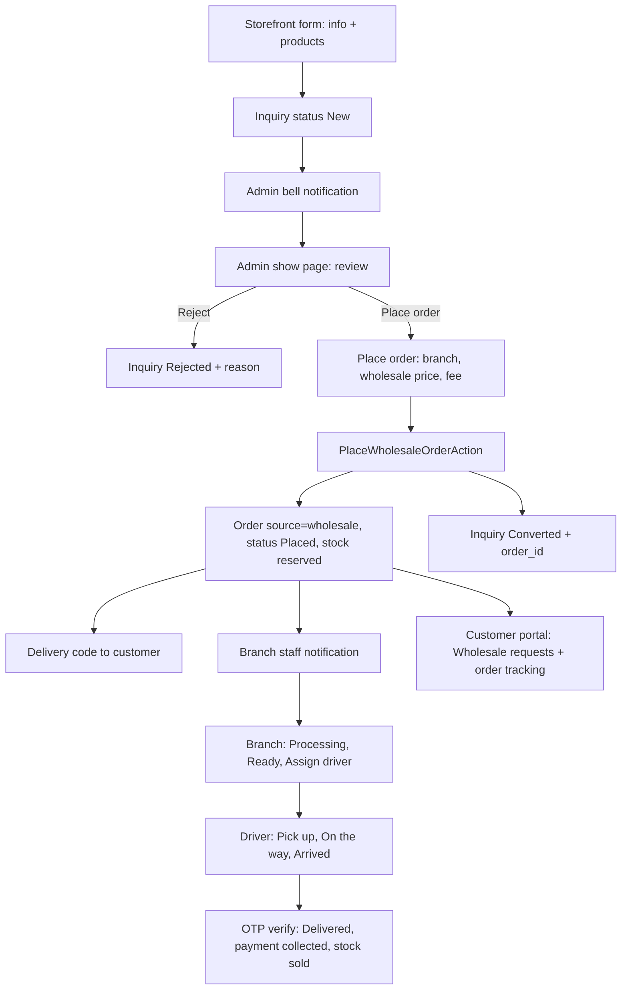

# Wholesale — Handoff Note

Wholesale Master Plan-এর পুরো plan, আসলে কী implement হয়েছে, plan থেকে কোথায় আলাদা হয়েছে, deploy-এর ধাপ, verification-এর ফলাফল আর বাকি কাজ — সব এক জায়গায়। Original plan file: `c:\Users\HP\.cursor\plans\wholesale_full_implementation_32ad2473.plan.md` (ওটা edit করা হয়নি)।

**অবস্থা (13 Oct 2026):** Phase 0–9 সব complete। চারবার পুরো recheck করা হয়েছে। এখনো commit করা হয়নি — সব পরিবর্তন working tree-তে আছে।

---

## ১. লক্ষ্য ও Flow

Storefront wholesale inquiry (product picker সহ) থেকে শুরু করে Admin review ও order তৈরি, Branch processing, Driver delivery আর Customer tracking পর্যন্ত পুরো flow dynamic করা। নতুন pipeline বানানো হয়নি — existing `Order` / `OrderFulfillment` / reservation / OTP pipeline reuse হয়েছে, `orders.source = wholesale` দিয়ে।



## ২. Engineering Guardrails (user-এর শর্ত — পরের কাজেও মানতে হবে)

- Existing website-এর অন্য কোনো feature-এ প্রভাব পড়বে না। Shared file-এ শুধু additive পরিবর্তন।
- Existing code structure আর UI structure হুবহু follow করতে হবে। নতুন pattern বা folder structure আনা যাবে না।
- Existing component থাকলে সেটাই ব্যবহার করতে হবে, page-local copy বানানো যাবে না। Common UI না থাকলে reusable component বানাতে হবে।
- Migration শুধু additive (nullable কলাম, নতুন টেবিল)। একমাত্র ব্যতিক্রম `wholesale_inquiries.message` nullable করা।
- `PlaceOrderAction` (checkout) আর `PlaceDriverOrderAction` (driver sale)-এর logic অপরিবর্তিত। শুধু order number shared helper-এ নেওয়া হয়েছে, format হুবহু একই (`PMM-YYYY-0001`)।
- `FulfillmentStatusService`, `DriverDeliveryService`, `DriverAssignmentService`, `InventoryReservationService` অপরিবর্তিত। Wholesale এগুলো শুধু call করে।
- Branch / Driver / Customer payload-এ শুধু নতুন key যোগ হয়েছে।
- Formatter (`npx vp fmt`) কখনো file list ছাড়া চালানো যাবে না — নিচে "Gotchas" দেখুন।

## ৩. Phase অনুযায়ী যা implement হয়েছে

### Phase 0 — Shared UI

- `resources/js/components/orders/order-source-badge.tsx` (`OrderSourceBadge`) — platform/branch/driver/customer সব জায়গায়।
- `resources/js/components/orders/wholesale-inquiry-status-badge.tsx` + `lib/order-badges.ts`-এ `wholesaleInquiryStatusBadgeClass()`।
- `resources/js/components/orders/payment-method-options.tsx` — driver-এর `place-order-payment-section.tsx` এটা re-export করে, তাই driver import ভাঙেনি।
- `resources/js/components/admin/reject-reason-dialog.tsx` — `confirm-delete-dialog`-এর structure অনুযায়ী।
- `resources/js/components/customer/account-list-pagination.tsx` — customer order, review আর wholesale request list share করে।

### Phase 1 — Permission ও Schema

- `PermissionEnum::MANAGE_WHOLESALE = 'manage-wholesale'` (guard `platform`, group `Orders`)। `RolesAndPermissionsSeeder` সব platform permission admin role-কে দেয়, তাই reseed করলেই পাবে।
- `routes/platform.php`: সব wholesale route `permission:manage-wholesale` group-এ। `nav.ts` আর `types/permissions.ts` আপডেট।
- Migrations:
  - `2026_10_13_090000_add_wholesale_pricing_to_products_and_branch_product_prices` — `wholesale_price` (decimal 10,2), `min_wholesale_qty` (unsigned int), দুটোই nullable।
  - `2026_10_13_090100_add_review_fields_to_wholesale_inquiries_table` — `customer_id`, `order_id`, `reviewed_by`, `reviewed_at`, `rejection_reason`, `admin_note`; `message` nullable। `down()` null message-এ `''` বসিয়ে আবার NOT NULL করে।
  - `2026_10_13_090200_create_wholesale_inquiry_items_table` — product FK `restrictOnDelete`, variant FK `nullOnDelete`, snapshot কলাম।
  - `2026_10_13_092756_add_lookup_indexes_to_wholesale_inquiries_table` — `(customer_id, created_at)` আর `order_id` index।
- `WholesaleInquiryStatus`: `New`, `Read`, `Converted`, `Rejected`; `isOpen()`, `label()`, `customerLabel()`।
- Model: `WholesaleInquiry` (`items`, `customer`, `order`, `reviewer`), নতুন `WholesaleInquiryItem` + factory।

### Phase 2 — Pricing

- `app/Support/BranchProductPriceDisplay.php`-এ নতুন method (existing method অপরিবর্তিত):
  - `wholesaleForProductContext(Product, ?BranchProductPrice)` — মূল resolution।
  - `wholesaleForBranchProduct`, `wholesaleAmount`, `minWholesaleQty`, `activeBranchPrice`, `usesBranchPricing` (`config('catalog.show_branch_pricing')`)।
  - Resolution order: branch `wholesale_price` (active row) → product `wholesale_price` → branch effective price → catalog effective price।
- Product form (`StoreProductRequest` / `UpdateProductRequest` / `ProductService` / `product-form.tsx`), branch price form (`UpsertBranchProductPriceRequest`, `product-inventory-panel.tsx`), catalog pricing (`UpsertCatalogProductPriceRequest`, `CatalogPricingService`, `CatalogProductPricingPayload`, `manage-catalog-pricing-page.tsx`)।
- Validation: `wholesale_price` nullable numeric `gt:0`; `min_wholesale_qty` nullable integer `min:1`। Empty string → `null` (clear করা যায়)।

### Phase 3 — Storefront

- `GET /wholesale/products` (`throttle:60,1`) → `Storefront\WholesaleInquiryController@products`, paginated, active product + active `variants`।
- `components/storefront/wholesale/wholesale-product-picker.tsx` — `InfiniteScrollCombobox` search, quantity stepper, min-qty hint, optional variant `Select` ("Any option"); অন্য line-এ নেওয়া variant disabled।
- `wholesale-form.tsx` — logged-in customer prefill, items submit (`variant_id` সহ)। CMS copy-র নিচে `wholesaleFormCopy` default merge হয়, কারণ আগে save করা CMS payload default-এর সাথে merge হয় না।
- `StoreWholesaleInquiryRequest` — items (max 50), `variant_id` (active), `after()` hook: variant অন্য product-এর হলে error, একই product+variant দুবার হলে error, তারপর `min_wholesale_qty` চেক। `message` লাগে শুধু items না থাকলে।
- `WholesaleInquiryService::store` — transaction-এ inquiry + items (`Product · Variant` নাম আর variant SKU snapshot), logged-in customer link, `PermissionRecipientResolver::platform(MANAGE_WHOLESALE)`-কে notification (link: inquiry show)।
- `CmsPageDefaults` — `fullName`, `products`, `productsHelp`, `productsPlaceholder`, `myRequests` keys।

### Phase 4a — Admin backend

- `App\Support\Order\OrderNumber::next()` — checkout, driver sale, wholesale তিনটাই এটা ব্যবহার করে।
- `App\Actions\Order\PlaceWholesaleOrderAction` — এক transaction-এ:
  1. `idempotency_key` replay (একই admin + wholesale source হলে existing order ফেরত)।
  2. Open inquiry `lockForUpdate`; closed হলে error।
  3. Customer: inquiry-র `customer_id` আগে, না থাকলে `CustomerResolutionService` (phone দিয়ে খোঁজে বা provisional বানায়; শুধু customer-type user গ্রহণ করে)।
  4. Duplicate line merge, active product/variant যাচাই (অন্য product-এর variant reject)।
  5. Branch inventory `lockOrdered` + available চেক (error: `items.{i}.quantity`)।
  6. Discount subtotal পর্যন্ত clamp; delivery fee explicit না হলে `BranchDeliveryQuote`।
  7. `Order` (Wholesale, Placed, `PendingCollection`, snapshot-এ company/email), একটা Placed fulfillment, items, reservations, history, `Payment` + `PaymentTransaction`।
  8. Inquiry → Converted + `order_id`।
  9. Commit-এর পরে: `OrderPlacementNotifier::issue`, customer notification ("Track order" link), `BranchOrderNotifier::newOrder`।
  - একই মুহূর্তে order number collide করলে message: "Another order was placed at the same moment. Please place this order again."
- `StoreWholesaleOrderRequest`, `RejectWholesaleInquiryRequest`, `UpdateWholesaleInquiryNoteRequest`।
- `App\Services\Order\BranchOrderNotifier` — branch-এর `manage-branch-orders` staff।
- `App\Services\Notifications\PermissionRecipientResolver` — `platform()` / `branch()`; recipient id কখনো hard-code নয়।
- `App\Services\Order\BranchDeliveryQuote`।
- Routes: `platform.wholesale-inquiries.{index,show,place-order,branch-options,reject,note}`, `platform.wholesale-orders.store` (`throttle:30,1`), `platform.wholesale-orders.delivery-quote`।

### Phase 4b — Admin UI

- Inquiry index: status filter/badge, items count, order link, closed inquiry-তে Place order লুকানো; search name/company/email/phone।
- Inquiry show: requested products, review card (reviewer, সময়, order link, rejection reason), customer link, internal note, Reject dialog, Place order (শুধু open থাকলে)।
- Place-order পেজ: inquiry থেকে prefill, branch picker (`only: ['branch','products']`), editable unit price, stock কম/না থাকলে warning ও submit block, discount, auto delivery fee (edit করলে আর auto হয় না), `PaymentMethodOptions`, delivery date (`DatePicker`, আজ থেকে), time slot, note (max 1000), per-mount `crypto.randomUUID` idempotency key।
- Variant: product row key `{product}` বা `{product}:{variant}`; variant-এর নিজের branch price row থাকলে সেটা, না থাকলে product-এর।
- Platform order show: source badge, "From wholesale inquiry" link (`manage-wholesale` থাকলে), notes।

### Phase 5 — Branch

- `BranchOrderFulfillmentDataTable`: `order.source` filter + options; `branch/orders/index.tsx`-এ Source filter।
- `Branch\OrderController::detail()`: `customerPhone`, `source`, `sourceLabel`, `notes`, `deliveryDate`, `timeSlot`; show পেজে badge/company/note।
- বাকি flow (Confirm → Packaging → Ready → Assign driver) অপরিবর্তিত।

### Phase 6 — Driver

- `Driver\OrderController::card()`: `company`, `source`, `sourceLabel`; `driver-order-card.tsx` আর order show-এ badge + company।
- OTP / payment collect / stock sale অপরিবর্তিত।

### Phase 7 — Customer

- `Customer\OrderController`: summary/detail-এ `source`, `sourceLabel`, `wholesaleRequestId`।
- `Customer\WholesaleRequestController` (`customer.wholesale-requests.index/show`) — শুধু নিজের inquiry; অন্যের হলে 404।
- Pages: `resources/js/pages/customer/wholesale-requests/{index,show}.tsx`; components: `wholesale-request-list.tsx`, `wholesale-request-types.ts`; `account-sidebar.tsx`-এ link।
- Guest inquiry convert হলে provisional customer-এর সাথে link হয়; account claim করলে order আর request দুটোই দেখা যায়।

### Phase 8 — Tests

- `tests/Feature/WholesaleInquiryTest.php` — items, min qty, customer link, admin notification, reject, 403, company search, variant snapshot, duplicate/foreign variant, picker variants।
- `tests/Feature/Platform/WholesaleOrderStoreTest.php` (17টা) — placement, reservation, Converted, idempotency, stock কম, provisional customer, price override, placement code, branch notification, notification link, variant order/listing, foreign variant, variant branch pricing, end-to-end delivery।
- `tests/Feature/WholesalePricingTest.php` — resolution order, catalog pricing save/clear।

### Phase 9 — Finalize

- Wayfinder generate (`--with-form`), Pint, `.ai/rules/wholesale*.md` ও `platform-wholesale*.md` আপডেট, `docs/COOLIFY_PRODUCTION_DEPLOYMENT.md`-এ deploy নোট।

## ৪. Plan থেকে যেখানে আলাদা হয়েছে

| Plan-এ ছিল | আসলে হয়েছে | কারণ |
| --- | --- | --- |
| `components/portal/*` | `components/orders/*` | Order-সংক্রান্ত shared component আগে থেকেই `components/orders/`-এ থাকে |
| `App\Support\OrderNumber` | `App\Support\Order\OrderNumber` | `Support/Order` namespace-এর সাথে মিল |
| Pricing শুধু `wholesaleAmount()` | মূল logic `wholesaleForProductContext()`-এ, `wholesaleAmount()` তার wrapper | Listing-এ আগে থেকে load করা price row দিয়ে N+1 এড়ানো |
| Variant নিয়ে কিছু বলা ছিল না | Storefront, admin আর action-এ পুরো variant support | Branch inventory variant-level, তাই না হলে stock ভুল মিলত |
| `ShippingCalculator` সরাসরি | `BranchDeliveryQuote` service + delivery-quote route | Place-order পেজে live fee আর action-এ একই হিসাব |

## ৫. সিদ্ধান্ত (user-এর উত্তর অনুযায়ী)

- Pricing: আলাদা কলাম (`wholesale_price`, `min_wholesale_qty`)।
- Storefront: product picker।
- Tracking: হ্যাঁ, guest-কে provisional customer দিয়ে link করা সহ।
- Storefront variant বাছাই optional ("Any option")।
- Variant নাম snapshot শুধু wholesale-এ; অন্য order source আগের মতো product নাম রাখে।
- Customer order cancel করলে inquiry "Converted"-ই থাকে (checkout-এর মতো)। User এখনো জানাননি বদলাতে চান কিনা।

## ৬. Deploy-এর ধাপ

1. `php artisan migrate` (৪টা নতুন migration)।
2. `php artisan db:seed --class=RolesAndPermissionsSeeder` — `manage-wholesale` তৈরি হবে আর admin role পাবে।
3. UI থেকে বানানো custom platform role-এ আগে `manage-users` দিয়ে wholesale access পেত — এখন তাদের হাতে `manage-wholesale` দিতে হবে।
4. Frontend build (Wayfinder file আগে থেকেই generate করা)।

## ৭. Verification (শেষ অবস্থা)

- Wholesale ও pricing tests: 51/51 pass।
- Full suite: 22টা fail — সবগুলো কাজ শুরুর আগে থেকেই fail করত (baseline), নতুন কোনো failure নেই:
  - Failures: OrderAllocationEngineScale, ProductEnablement, ProductCatalogPricing, BranchStaffOverview, RoleExport, WorkforceShift ×2, OrderAssignHistory
  - Errors: CustomerProductToReview ×12, DriverPortalChrome ×2
  - `CrossPortalAccessTest` "driver to customer" parallel run-এ মাঝে মাঝে 503 দেয়, একা চালালে pass করে।
- TypeScript: 180টা error = baseline, কোনোটা wholesale ফাইলে না।
- Lint: পরিবর্তিত ৪২টা frontend ফাইল clean (শুধু আগে থেকে থাকা warning: `platform/orders/show.tsx`, `cms-payload-fields.tsx`)।
- Pint: pass।

### চালানোর command

```powershell
php vendor/bin/pest --compact tests/Feature/WholesaleInquiryTest.php tests/Feature/Platform/WholesaleOrderStoreTest.php tests/Feature/WholesalePricingTest.php tests/Feature/CatalogPricingTest.php
vendor/bin/pint --dirty --format agent
npx tsc --noEmit   # error count 180 হলে baseline
```

Full suite (backup test দুটো বাদ দিয়ে):

```powershell
$x = (Get-Content phpunit.xml -Raw) -replace '<directory>tests/Unit</directory>','<directory>tests/Unit</directory><exclude>tests/Unit/BackupZipSqlLocatorTest.php</exclude>' -replace '<directory>tests/Feature</directory>','<directory>tests/Feature</directory><exclude>tests/Feature/Platform/DatabaseBackupTest.php</exclude>'; Set-Content phpunit.check.xml $x; php vendor/bin/pest --compact --parallel -c phpunit.check.xml; Remove-Item phpunit.check.xml
```

## ৮. Gotchas

- **`npx vp fmt` সবসময় explicit file array দিয়ে চালাতে হবে।** PowerShell-এ `$files = 'a.tsx'; npx vp fmt @files` লিখলে file যায় না, আর formatter পুরো repo reformat করে ফেলে। একবার এভাবে প্রায় ৩০০ ফাইল reformat হয়েছিল, পরে commit করা অবস্থায় ফেরত আনা হয়েছে। নিরাপদ উপায়: `[string[]]$files = @('a.tsx','b.tsx'); npx vp fmt @files`।
- `vp fmt` / `vp lint` অন্য command-এর সাথে chain করলে মাঝে মাঝে panic করে আটকে যায় — আলাদা আলাদা চালান।
- Saved CMS page payload `CmsPageDefaults`-এর সাথে merge হয় না। নতুন copy key যোগ করলে frontend-এ default fallback রাখতে হবে (যেমন `wholesale-form.tsx`)।
- কিছু shared ফাইলে (`product-inventory-panel.tsx`, `platform/orders/show.tsx`, `branch/orders/*`) formatter-এর indentation ঠিক করাও আছে, কারণ commit করা ফাইলে indentation আগে থেকেই ভুল ছিল। Behaviour বদলায়নি; চাইলে শুধু আসল পরিবর্তন রেখে বাকিটা সরানো যায়।

## ৯. বাকি কাজ (optional, user-এর সিদ্ধান্তের অপেক্ষায়)

- Place-order পেজে nearest-branch sort (দূরত্ব অনুযায়ী)।
- Branch dashboard-এ "Pending wholesale orders" count card।
- Customer order cancel করলে inquiry status বদলানো হবে কিনা।
- Reverb/Echo wiring (notification real-time) — আলাদা follow-up, wholesale-এর অংশ না।
